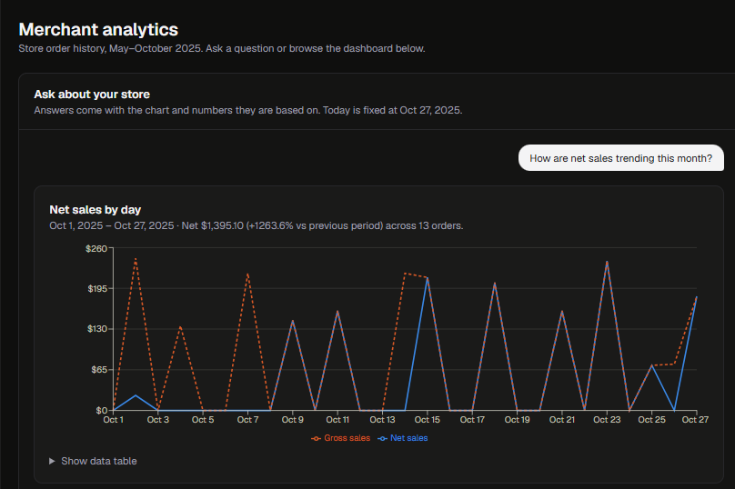
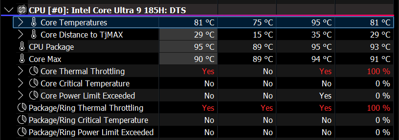

# Merchant Analytics Dashboard

A Next.js (TypeScript) dashboard over the Store Order History export for **May–October 2025**
(28 line items across 20 orders). It computes five merchant metrics, each with its own function and chart,
and tests every metric against the CSV.

## Running it

Requirements: Node.js 20.9+ and npm.

```bash
npm install
npm run dev        # http://localhost:3000
```

Production build and start:

```bash
npm run build
npm start          # http://localhost:3000
```

Tests:

```bash
npm test           # vitest run (one-off)
npm run test:watch # vitest in watch mode
```

Lint and typecheck:

```bash
npm run lint
npx tsc --noEmit
```

The page opens with a chat window (see [Chat UI](#chat-ui)) above the dashboard. The dashboard reads
`?range=last-week` or `?range=this-month` (default: this month). The chat needs `OPENROUTER_API_KEY` (see
[Chat API](#chat-api)). The dashboard works without it.

## Dataset

File: `data/store_order_history-may_to_october_2025.csv` (committed, read at runtime).

- **Load behaviour.** The loader parses every row and keeps every row. Nothing is dropped, deduplicated,
  or mutated. Returned items stay in the dataset. Returns, refunds, and order rollups are handled inside the
  metric functions.
- **Validation.** The loader rejects the file (with row numbers) if the header is wrong, a date is not a real
  `YYYY-MM-DD`, a boolean is not `true`/`false`, `line_total ≠ quantity × unit_price − discount_amount`, a returned
  line lacks `return_date` or `return_reason`, a non-returned line has return fields, a refund is outside
  `[0, line_total]`, or lines sharing an `order_id` disagree on `order_date` or `customer_id`.
- **Currency.** The CSV has no currency column. Amounts are displayed as USD.
- **Repeat flag.** `is_repeat_customer` is recorded per line at order time. The dashboard uses it as given.

Shape of the data as loaded: 28 lines, 20 unique `order_id`s, 8 returned lines, returns dated 2025-07-08
through 2025-10-27.

## Date rules

All calculations use inclusive `YYYY-MM-DD` bounds. "Today" is fixed at **2025-10-27**.

| Preset | Window | Notes |
|---|---|---|
| Last week | `2025-10-20` → `2025-10-26` | Monday through Sunday |
| This month | `2025-10-01` → `2025-10-27` | Month-to-date |

- **Weeks** are Monday to Sunday. `weekStart()` returns the Monday of the week containing a date.
- **Previous period** is the equal-length window immediately before the current one. Last week compares with
  `2025-10-13`–`2025-10-19`. This month compares with `2025-09-04`–`2025-09-30` (27 days, the same length as
  month-to-date). The previous period is not the same days of the prior month. If you want the prior month
  instead, change `previousPeriod()` in `src/lib/data/dates.ts`.
- **Cohort rule.** Order-cohort metrics (net sales, AOV, repeat customers, category/channel) filter on
  `order_date`. Returns metrics filter on `return_date` by default. Pass `dateField: "order_date"` to
  `returnsRefunds()` to filter on the order date instead.

## Metrics and formulas

Every metric is a function `(startDate, endDate, options?)` in `src/lib/metrics/`. `options.lines` overrides the
dataset, which the tests use for fixtures.

### 1. Net sales — `netSales()` — line chart

| Figure | Definition |
|---|---|
| `grossSales` | `SUM(line_total)` for lines with `order_date` in the window |
| `discounts` | `SUM(discount_amount)`. Informational only: `line_total` is already net of discount, so it is not subtracted again |
| `refunds` | `SUM(refund_amount)` for the same lines, counted against the order date even if the return happened later |
| `netSales` | `grossSales − refunds` (= `SUM(line_total) − SUM(refund_amount)`) |
| `orderCount` | `COUNT(DISTINCT order_id)` |
| `daily` | One zero-filled point per calendar day (gross, refunds, net) |
| `netSalesChangePct` | `(net − prevNet) / |prevNet| × 100`, rounded to 0.1. `null` when the previous period is 0 |

### 2. Average order value — `averageOrderValue()` — weekly bar chart with AOV callout

- Line items are rolled up to one row per `order_id`: `total = SUM(line_total)` and `itemCount = SUM(quantity)`.
- `averageOrderValue = SUM(order total) / COUNT(DISTINCT order_id)` over the window's orders.
- `weekly` buckets orders by Monday-start week, with per-week order count, revenue, and AOV.
- A multi-item order is one order. It is never counted once per line.

### 3. Repeat customers — `repeatCustomers()` — donut chart

- `buyers = COUNT(DISTINCT customer_id)` for in-window lines.
- A buyer is **returning** if any in-window line has `is_repeat_customer = true`, otherwise **new**.
- `returningSharePct = returning / buyers × 100`.
- `multiOrderBuyers` counts buyers with `COUNT(DISTINCT order_id) > 1` inside the window.

The flag is stored per line at order time, so "returning" describes the customer's status in this window,
not a lifetime count. A customer with mixed flags counts as returning.

### 4. Returns and refunds — `returnsRefunds()` — bar chart by reason

- Filters on `return_date` by default. Pass `{ dateField: "order_date" }` to use the order date.
- `returnedItemCount = SUM(quantity)` over returned lines. `returnedLineCount` is the number of lines.
- `refundTotal = SUM(refund_amount)` over the same lines.
- `byReason` groups by `return_reason`, sorted by refund total (descending), then item count, then name.

These figures use a different date basis from net sales (return date here, order date there). That is why the
dashboard labels them separately.

### 5. Sales by category and channel — `salesByCategoryAndChannel()` — stacked bar chart

Order-date cohort. Gross and net for each `product_category`, `product_title` (by `product_id`), and
`sales_channel`, plus a category × channel matrix for the stacked chart. Net = gross − refunds, same as above.

Channel colours are assigned in a fixed order (Online Store, Shop app, Point of Sale, Instagram). A channel
keeps its colour when the filter changes. Any channel outside that list is shown in grey as "Other".

## Chat API

`POST /api/chat` streams answers to merchant questions ("which jackets came back as returns last week?") using the
Vercel AI SDK (`ai`) and OpenRouter (`@openrouter/ai-sdk-provider`).

Setup:

```bash
cp .env.example .env.local     # then set OPENROUTER_API_KEY
```

| Variable | Default | Purpose |
|---|---|---|
| `OPENROUTER_API_KEY` | none (required) | OpenRouter key. `.env*` is gitignored, only `.env.example` is committed |
| `OPENROUTER_MODEL_ID` | `google/gemma-4-31b-it:free` | Any OpenRouter model id |

Request: `{ "messages": UIMessage[] }` (the AI SDK `useChat` shape). Response: a UI message stream
(`toUIMessageStreamResponse()`) containing the tool call, its structured result, and the streamed answer.

How it works:

- **Date anchoring.** "Today" is fixed at Monday `2025-10-27`. `resolveDateRange()` (`src/lib/data/dates.ts`) computes the
  exact ranges for today, yesterday, this week, last week, this month, last month and all time (`2025-05-06` to
  `2025-10-27`). They are written into the system prompt as a lookup table, so the model copies date strings instead of
  doing calendar arithmetic. "This week" is Mon to today because the rest of the week is in the future.
- **Tools** (`src/lib/chat/tools.ts`): `getSalesMetrics`, `getReturnsMetrics`, `getRepeatCustomerMetrics`,
  `getAverageOrderValue`. Each takes `startDate` / `endDate` (`YYYY-MM-DD`, Zod-validated); sales and returns also take
  optional `category` and `product` filters. Every result has `summary` numbers plus chart-ready series under `charts`.
  `getReturnsMetrics` also returns `charts.returnsByReason` and `charts.returnsByProduct` (item count and refunds per
  reason / product, for bar charts) and `returnedItems`: one row per returned order line with `product`, `variant`,
  `returnDate`, `reason` (`"Unspecified"` if blank) and `refundAmount`, newest return first. Both reconcile to
  `summary.refundTotal`.
- **Guardrails.** Dates pass through `clampToDatasetBounds()`: invalid dates fall back to the dataset bounds,
  out-of-range dates are clamped, reversed ranges are swapped, and the result carries a `dateNote` when anything changed.
- **One tool call.** `stopWhen: stepCountIs(2)`: step 1 is the tool call, step 2 is the written answer. The prompt also asks
  for at most one call. Ad spend, ROAS and other unsupported metrics get a polite explanation.
- **Errors.** An OpenRouter 429 returns HTTP 429 with `{ "error": "rate_limited", "message": ... }` and `Retry-After`.
  A missing key or malformed body returns a JSON 500 or 400. A 429 that happens mid-stream arrives as a stream error
  with the same message.

Try it (needs a real key):

```bash
curl -N -X POST http://localhost:3000/api/chat -H "content-type: application/json" \
  -d '{"messages":[{"id":"1","role":"user","parts":[{"type":"text","text":"which jackets came back as returns last week"}]}]}'
```

The tests use a scripted mock model, so they check the wiring (prompt, tool choice and arguments, step cap, 429
handling) but not how well Gemma 4 picks tools. That needs a live run.

## Chat UI




`src/components/chat/ChatPanel.tsx` is a client component that uses `useChat` from `@ai-sdk/react` with a
`DefaultChatTransport` pointed at `/api/chat`. Messages are typed with `InferUITools<ChatTools>`, so each tool part
carries its real output type.

- **Thread and input.** A scrolling message thread, a text input with Send (Stop while streaming), and quick-start
  chips, including "Which jackets came back as returns last week?".
- **Chart per answer.** Assistant messages are rendered part by part. Tool parts become chart cards built from the same
  components as the dashboard (`src/components/chat/ToolResult.tsx`). The model's text is rendered below them as it
  streams (a small renderer handles paragraphs, lists and `**bold**`).

  | Tool | Rendered as |
  |---|---|
  | `getSalesMetrics` | Net sales line chart, plus the category × channel stacked bar when there is data |
  | `getAverageOrderValue` | Weekly AOV bar chart with an AOV callout tile |
  | `getRepeatCustomerMetrics` | New vs returning donut |
  | `getReturnsMetrics` | Refunds-by-reason bar chart, plus a table of returned order lines (`returnedItems`) |

  Every card keeps the "Show data table" view. For returns it shows the reason and per-product breakdowns.
- **Date notes.** If a tool result has a `dateNote` (dates clamped to the dataset bounds), an amber banner appears
  above that chart.
- **Loading.** A shimmer card appears while the request is `submitted`, while the stream is open with nothing to show
  yet (including model reasoning), and in place of a chart whose tool call has no `output` yet. A text shimmer covers the
  gap between the chart and the first summary token. The animation is off under `prefers-reduced-motion`.
- **Errors.** An HTTP 429 or a mid-stream rate-limit error shows a "Rate limited" banner. Other failures show the
  route's message. Both banners have Retry (`regenerate()`) and Dismiss buttons. A tool that fails shows its error inline.

## Charts and accessibility

- Palette: the validated categorical slots from the data-viz reference (`src/components/charts/theme.ts`).
  The validator reports a light-mode contrast warning for the aqua and yellow slots, so every chart also has a
  "Show data table" view that carries the same numbers.
- Dark mode follows the OS setting (`prefers-color-scheme`). There is no in-page toggle.
- Charts with two or more series have a legend.

## Project layout

```
data/                          CSV dataset (read at runtime)
src/lib/data/                  CSV parser, loader and validation, dates, money, order rollup
src/lib/metrics/               one file per metric; (startDate, endDate, options) signatures
src/lib/dashboard.ts           runs all metrics for one window
src/lib/chat/                  system prompt (date table), AI SDK tools, streamText wiring
src/app/api/chat/route.ts      streaming chat endpoint (OpenRouter)
src/lib/tests/                 vitest suites (dataset, dates, metrics, fixtures)
src/components/charts/         recharts client components
src/components/chat/           chat window (useChat), per-tool chart cards, loading skeleton
src/app/page.tsx               server page: chat in the static shell, dashboard streamed per ?range
```

## Tests

`src/lib/tests/` covers:

- the CSV parser (quotes, escaped quotes, CRLF, empty fields),
- the loader's validation rules and the real dataset (28 rows, 20 orders, 8 returns),
- the date rules (presets, Monday weeks, previous period, inclusive bounds),
- the chat wiring (date table, one tool call, step cap, 429 handling) and the returns tool's `returnedItems` and
  per-product series (last week's jacket return; totals reconcile to the refund total),
- every metric against figures computed independently from the CSV: net sales, AOV (including a multi-item
  order), repeat buyers, returns by return date and by order date, and category/channel totals reconciling to
  the window total.

## Deploying

Standard Next.js app. `npm run build` followed by `npm start`, or deploy to any Node-capable host. The dashboard
reads `data/` from the working directory at runtime, so the `data/` folder must ship with the app.
